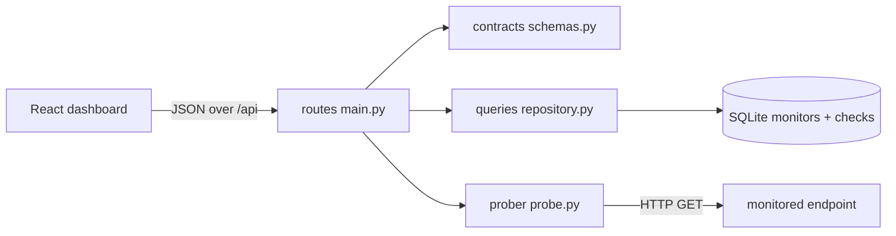

# UptimeKit

**Self-hosted API uptime and latency monitoring. FastAPI + React + SQLite, no external services.**

[](https://github.com/ROYAL-SMP/uptimekit/actions/workflows/ci.yml)
[](https://www.python.org/)
[](https://react.dev/)
[](LICENSE)
[](backend/tests)

SaaS uptime monitors charge per check and keep your probe history behind a paywall. UptimeKit inverts that: one container, one SQLite file, every probe you have ever taken, yours to query. It records status codes and latency per endpoint, rolls them into an uptime percentage, and exposes a badge endpoint you can drop straight into a README.



## Features

- **Monitor CRUD** — register any HTTP endpoint with its own check interval (30s–24h).
- **Explicit probing** — `POST /api/monitors/{id}/check` runs a probe now and stores it. No hidden timer you cannot observe.
- **Honest failure capture** — timeouts, DNS and TLS errors are recorded as failed checks with the reason, never swallowed.
- **Rolling uptime** — percentage of successful probes and mean latency, computed from real history.
- **Badge endpoint** — `GET /api/monitors/{id}/badge` returns shields.io endpoint text.
- **Pause without deleting** — stop probing an endpoint while keeping its history.

## Quick start

```bash
docker compose up --build     # UI :5173, API :8000
```

Without Docker:

```bash
cd backend && pip install -e ".[dev]" && uvicorn app.main:app --reload --port 8000
cd frontend && npm install && npm run dev
```

Vite proxies `/api` to port 8000, so there is no CORS setup in development.
